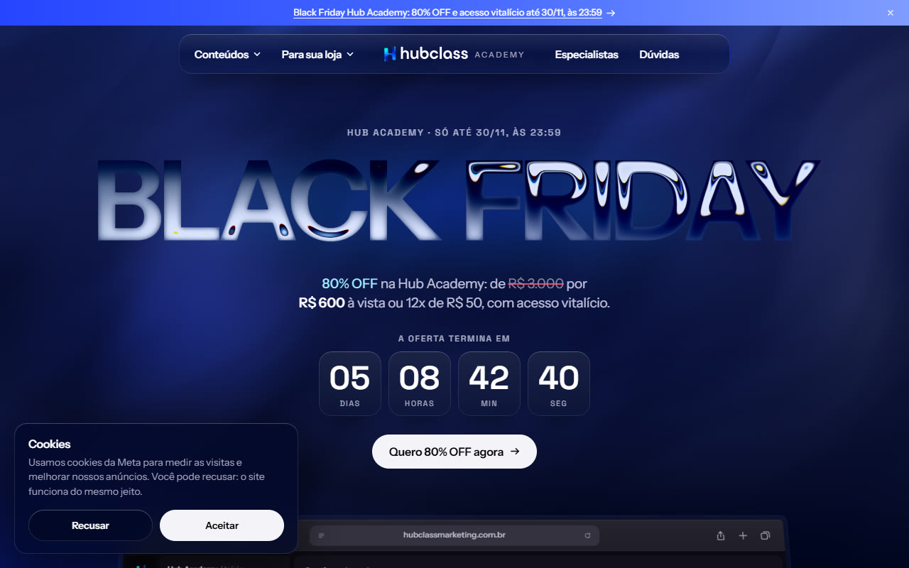
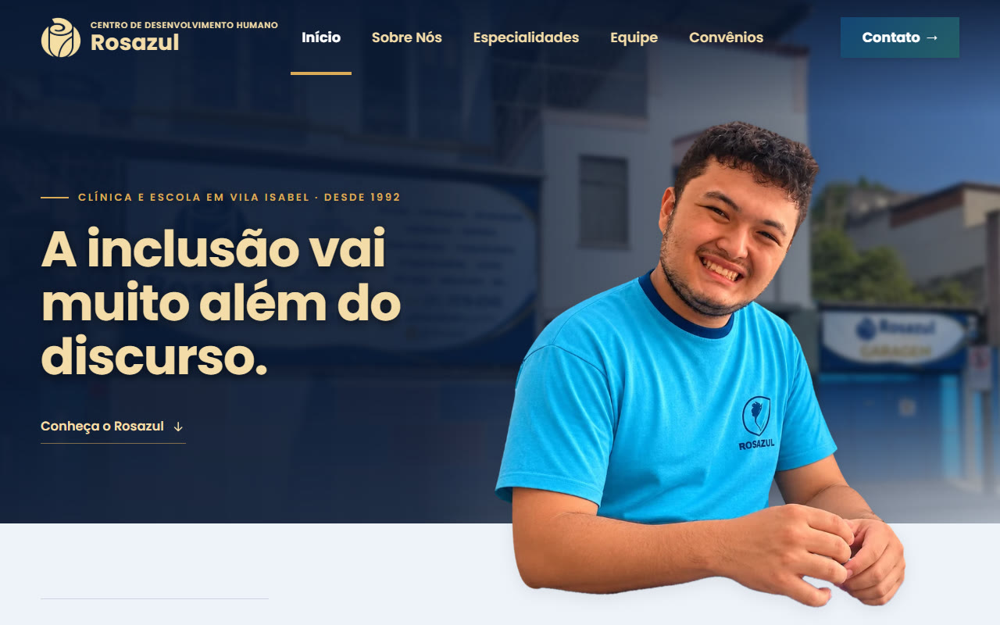
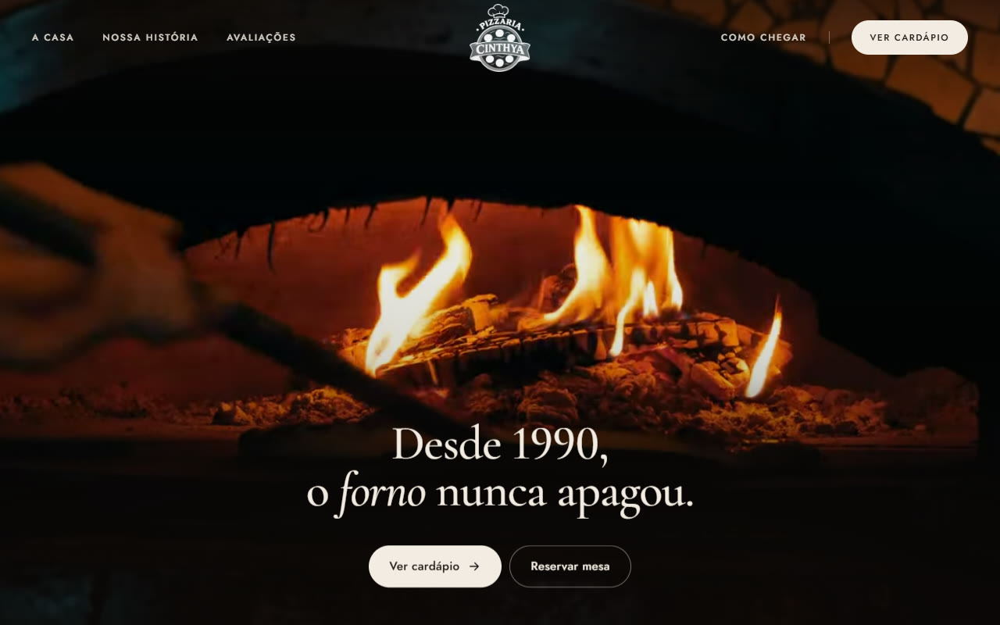
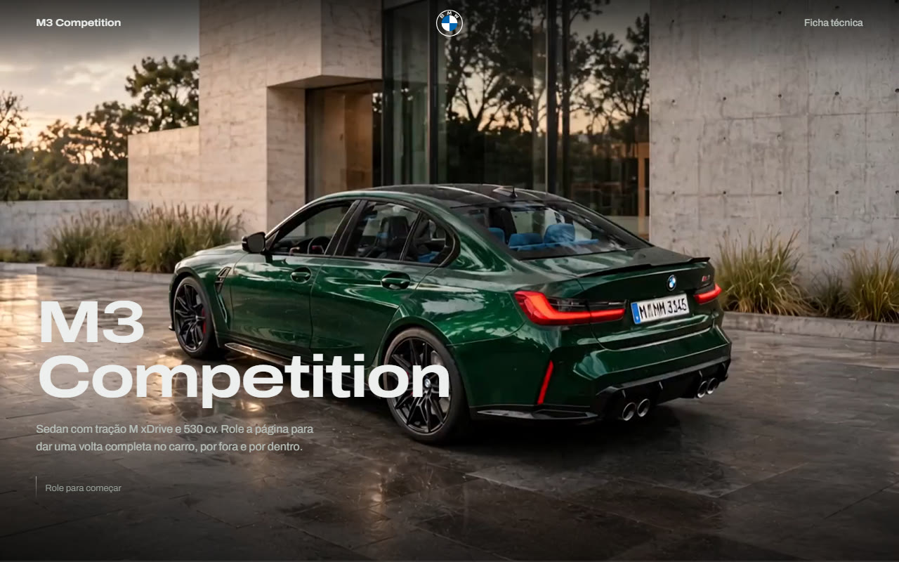

<div align="center">


<br>


<br>

<sub>

**[Sobre](#-sobre)** &nbsp;·&nbsp; **[Projetos](#-projetos)** &nbsp;·&nbsp; **[Seções](#-seções)** &nbsp;·&nbsp; **[Rodando](#-rodando-localmente)** &nbsp;·&nbsp; **[Adicionar um projeto](#-adicionar-um-projeto)** &nbsp;·&nbsp; **[Estrutura](#-estrutura)**

</sub>

</div>

<br>

<table>
  <tr>
    <td width="25%"></td>
    <td width="25%"></td>
    <td width="25%"></td>
    <td width="25%"></td>
  </tr>
</table>

## ◆ Sobre

Meu portfólio em uma página, em preto, branco e vermelho. O topo traz um **vídeo em loop com fundo transparente**, que encolhe ao rolar e revela uma parede com os projetos atrás. Logo abaixo, cada **projeto aparece em vídeo** e vai subindo por cima do anterior conforme a rolagem. As seções se ligam por **transições em arco**.

Feito com HTML, CSS e JavaScript puros, sem build e sem framework. **GSAP** (ScrollTrigger e SplitText) cuida das animações, e o **Lenis** da rolagem suave.

O site está em **português, inglês e espanhol**: o idioma vem do navegador, de `?lang=pt|en|es` na URL ou da escolha no cabeçalho, que fica salva.

No celular e no tablet o site não roda vídeo nenhum: o topo mostra a foto e os projetos e o reel mostram os pôsteres. Ele também respeita a preferência de sistema por menos movimento (`prefers-reduced-motion`): as animações viram transições simples e o topo mostra a foto.

## ◆ Projetos

Os projetos aparecem na ordem de `projects.js`. Cada um tem uma prévia em vídeo de 12,5 s a 30 fps, gravada do site no ar, e uma capa.

| Projeto | O que é | Stack |
| --- | --- | --- |
| [HubClass](https://hubclass.vercel.app/) | Landing da Black Friday da Hub Academy, plataforma de cursos do mercado mobile | Vite, GSAP, ScrollTrigger |
| [Rosazul](https://siterosazul.vercel.app/) | Site da clínica multidisciplinar e escola inclusiva em Vila Isabel | GSAP, SplitText, Supabase |
| [Pizzaria Cinthya](https://pizzaria-cinthya.vercel.app/) | Landing do rodízio de massas em Nova Iguaçu, desde 1990 | HTML, CSS, JavaScript |
| [BMW M3](https://github.com/gabrielnovaesdev/BMW-Landingpage) | Volta pela BMW M3 Competition guiada pela rolagem | GSAP, ScrollTrigger, vídeo H.264 |
| [Monólito](https://github.com/gabrielnovaesdev/monolito) | Estúdio de arquitetura com cena 3D modelada no Blender | three.js, GSAP, Blender |
| [NovaeStore](https://github.com/gabrielnovaesdev/NovaeStore) | Loja de games com catálogo, carrinho e checkout via Pix | React, TypeScript, Supabase |
| [Órbita](https://github.com/gabrielnovaesdev/Iphone) | Vitrine da linha iPhone 17 com os aparelhos em movimento | GSAP, Lenis, vídeo WebM |
| [Nébula](https://github.com/gabrielnovaesdev/Nebula) | Estúdio fictício com orbe 3D interativo | three.js, GSAP, Lenis |

## ◆ Seções

| Seção | O que acontece |
| --- | --- |
| Entrada | "Bem-vindo ao portfólio de" e o nome, que voa até o logo enquanto uma cortina em arco revela o site, sempre que a página é carregada |
| Topo | Vídeo em loop que segue o mouse; passar o mouse no rosto imprime pontos brancos e vermelhos (halftone). Ao rolar, encolhe e revela a parede de projetos |
| Projetos selecionados | Arco branco sobe, a lista avança com a rolagem e cada vídeo entra por cima do anterior |
| Por que trabalhar comigo | Arco preto cobre os projetos; linhas vermelhas acendem ao passar o mouse |
| Por trás do código | O reel começa como um cartão e se abre até ocupar a tela, com botão de som |
| Serviços | Cartões correm na horizontal; o ativo se enche de branco |
| Tudo no ar | Lista com prévia flutuante; as linhas vibram como corda e tocam uma nota |
| Ferramentas | Logos voam em profundidade |
| Processo | Carrossel com as etapas de um projeto |
| Perguntas frequentes | Acordeão |
| Rodapé | Cartão de contato e formulário em modal |

## ◆ Rodando localmente

Não precisa instalar nada. Abra o `index.html` no navegador, ou, se preferir um servidor local:

```bash
python -m http.server 5500   # http://localhost:5500
```

GSAP, ScrollTrigger, SplitText e Lenis vêm de CDN, então é preciso estar online.

O formulário de contato envia as mensagens pelo [Web3Forms](https://web3forms.com). Coloque a sua chave de acesso em `WEB3FORMS_KEY`, no começo do `main.js`, e elas chegam no e-mail cadastrado na chave. Enquanto ela estiver vazia, o formulário abre o GitHub.

## ◆ Adicionar um projeto

1. Coloque o vídeo e a capa em `assets/projects/<slug>.mp4` e `assets/projects/<slug>.jpg`, em 1280×800 (16:10)
2. Acrescente um objeto em `projects.js`:

```js
{
  slug: "meu-projeto",
  name: "Meu projeto",
  kind: "Landing page · Segmento",
  description: "Uma frase sobre o que é.",
  stack: ["HTML", "CSS"],
  live: "https://...",      // ou null
  repo: "https://github.com/gabrielnovaesdev/...",  // ou null se for privado
}
```

3. Em `i18n.js`, acrescente o tipo do projeto em inglês e espanhol em `kinds` (pela `slug`). Sem isso, aparece o tipo em português.

A lista e a altura da seção de projetos se ajustam sozinhas à quantidade de itens.

## ◆ Estrutura

```text
├── index.html       Estrutura de todas as seções
├── styles.css       Cores, tipografia, layout e responsivo
├── main.js          Animações, rolagem, vídeos, carrossel, FAQ e contato
├── i18n.js          Textos em português, inglês e espanhol e o seletor de idioma
├── projects.js      Lista de projetos exibidos
├── privacidade.html Política de privacidade (formulário de contato e serviços de terceiros)
└── assets/
    ├── hero-loop-poster.webp       Primeiro quadro do vídeo: foto do topo (Safari, celular, menos movimento)
    ├── hero-loop.webm              Vídeo do topo com fundo transparente (VP9 + alfa)
    ├── reel-720.mp4                Reel da seção "Por trás do código"
    ├── projects/                   Prévia em vídeo e capa de cada projeto
    └── stack/                      Logos das ferramentas
```

<br>

<div align="center"><sub>Feito por <a href="https://github.com/gabrielnovaesdev">Gabriel Novaes</a></sub></div>
