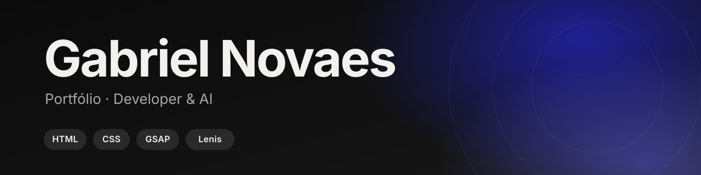
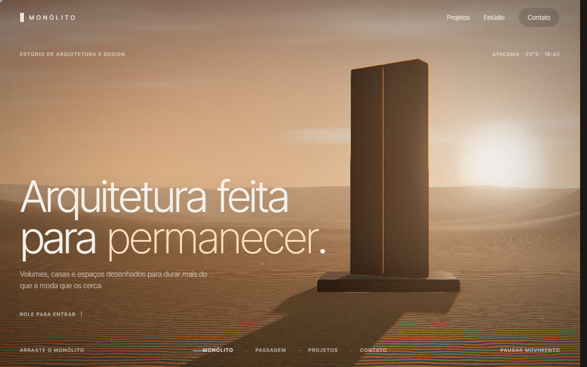
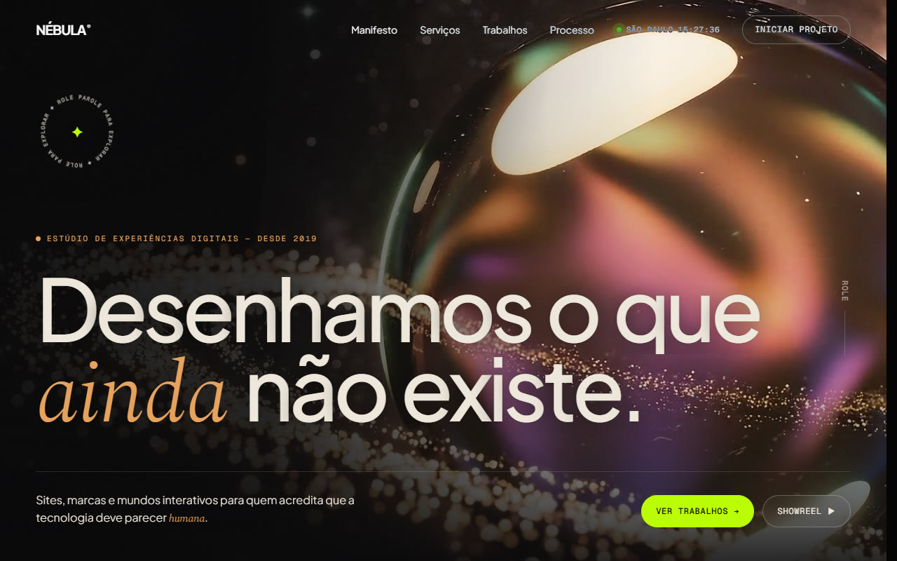
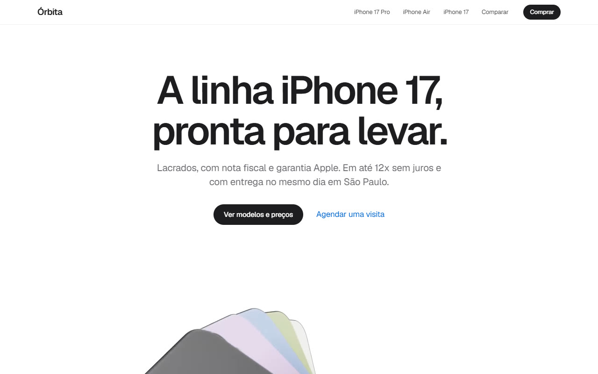

<div align="center">



<br>


<br>

<sub>

**[Sobre](#-sobre)** &nbsp;·&nbsp; **[Projetos](#-projetos)** &nbsp;·&nbsp; **[Rodando](#-rodando-localmente)** &nbsp;·&nbsp; **[Adicionar um projeto](#-adicionar-um-projeto)** &nbsp;·&nbsp; **[Estrutura](#-estrutura)**

</sub>

</div>

<br>

<table>
  <tr>
    <td width="33%"></td>
    <td width="33%"></td>
    <td width="33%"></td>
  </tr>
</table>

## ◆ Sobre

Meu portfólio: uma página com **abertura animada**, **foto com entrada em camadas**, um reel que toca sozinho enquanto está na tela e uma **lista de projetos** com vídeo de cada um. Feito com HTML, CSS e JavaScript puros; **GSAP e ScrollTrigger** cuidam das animações e o **Lenis** da rolagem suave. Sem build e sem framework.

O site respeita a preferência de sistema por menos movimento (`prefers-reduced-motion`).

## ◆ Projetos

Os projetos aparecem na ordem de `projects.js`. Cada um tem vídeo e pôster, descrição, stack e links.

| Projeto | O que é | Stack |
| --- | --- | --- |
| [Monólito](https://github.com/gabrielnovaesdev/monolito) | Site de estúdio de arquitetura com cena 3D modelada no Blender, renderizada ao vivo | three.js, GSAP, Blender |
| [Nébula](https://github.com/gabrielnovaesdev/Nebula) | Estúdio fictício com orbe 3D interativo, sem framework | three.js, GSAP, Lenis |
| [Órbita](https://github.com/gabrielnovaesdev/Iphone) | Vitrine da linha iPhone 17 com os aparelhos em movimento | GSAP, Lenis, vídeo WebM |
| [NovaeStore](https://github.com/gabrielnovaesdev/NovaeStore) | Loja de games com catálogo, carrinho e checkout via Pix | React, TypeScript, Supabase |
| [BarberGo](https://github.com/gabrielnovaesdev/BarberGo) | App que leva o barbeiro até você, do agendamento ao atendimento | React Native, Expo |
| [Spotify](https://github.com/gabrielnovaesdev/SpotifyRework) | Recriação responsiva da landing page do Spotify | HTML, CSS, Bootstrap |

## ◆ Rodando localmente

Não precisa instalar nada. Abra o `index.html` no navegador, ou, se preferir um servidor local:

```bash
python3 -m http.server 8000   # http://localhost:8000
```

GSAP, ScrollTrigger e Lenis vêm de CDN, então é preciso estar online.

## ◆ Adicionar um projeto

1. Coloque o vídeo e o pôster em `assets/projects/<slug>.mp4` e `assets/projects/<slug>.jpg`
2. Acrescente um objeto em `projects.js`:

```js
{
  slug: "meu-projeto",
  name: "Meu projeto",
  kind: "Site institucional",
  description: "Uma frase sobre o que é.",
  stack: ["HTML", "CSS"],
  live: "https://...",      // ou null
  repo: "https://github.com/gabrielnovaesdev/...",
  device: "phone",          // opcional: mostra a prévia dentro de um celular
}
```

## ◆ Estrutura

```text
├── index.html       Abertura, intro, lista de projetos e rodapé
├── styles.css       Cores, tipografia e layout
├── main.js          Entrada do hero, rolagem, reel e animações
├── projects.js      Lista de projetos exibidos
└── assets/          Fotos, reel e vídeos/pôsteres de cada projeto
```

<br>

<div align="center"><sub>Feito por <a href="https://github.com/gabrielnovaesdev">Gabriel Novaes</a></sub></div>
